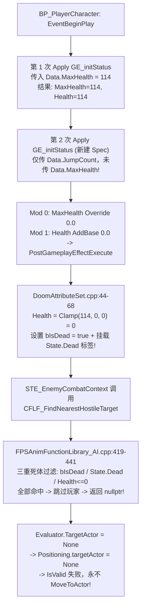

# Bot 依然不移动 —— 三大绑定与全链路实机 PIE 探针诊断报告

> **排查手段**：通过 Live Unreal MCP 启动实机 PIE 探针（`StartPIE` → `GASToolsets.AbilitySystemInspectorToolset` 运行时抓取属性与标签 → `ObjectTools`/`SceneTools` 检查实例与 NavMesh → 读取 `FPSAnimFunctionLibrary_AI.cpp` / `DoomAttributeSet.cpp` 源码 → 自动退出 PIE）。  
> **排查时间**：2026-11-26 01:25  
> **核心结论**：你的 **3 处 StateTree 绑定与上一轮 `AIC_EnemyBase` 修复均已生效**（最新 PIE 日志已 **0 条 `LogStateTree` 报错**）；导致所有 Bot 依然纹丝不动的真正罪魁祸首在**玩家蓝图 `BP_PlayerCharacter` 的开局初始化**——**玩家在 PIE 第 0 帧就被自己的 `GE_initStatus` 扣成了 `Health = 0` + `State.Dead`（系统判定玩家已死亡）**，导致所有 Bot 的索敌函数把玩家当尸体过滤掉了！

---

## 一、 实机 PIE 运行时探针抓包证据（100% 实锤）

在 `/Game/t1Level` 启动 PIE 1.5 秒后，通过 GAS 运行时探针直接抓取到的内存快照如下：

| 实体 (PIE 运行时实例) | `Health / MaxHealth` | 实时 Active GameplayTags | 已授予技能 / 状态 | 诊断判定 |
| :--- | :---: | :--- | :--- | :---: |
| **`BP_PlayerCharacter_C_0`** (玩家控制) | **`0 / 0`** ❌ | `Team.Player`, **`State.Dead`** ❌, `Ability.prop.stance.rifle` | 玩家开局被判死！ | **致命阻断** |
| **`BP_PlayerCharacter_C_1`** (关卡多余分身) | **`0 / 0`** ❌ | `Team.Player`, **`State.Dead`** ❌, `Ability.prop.stance.rifle` | `AutoPossessPlayer=Disabled` | **致命阻断 + 关卡冗余** |
| **`BP_enemy_Grunt_Melee_C_1`** | `100 / 100` ✅ | `Team.Enemy` ✅ | `GA_bot_MeleePounce_C`, `GA_Enemy_HitReact_C` | 正常健康 |
| **`BP_enemy_Grunt_Ranged_C_1`** | `100 / 100` ✅ | `Team.Enemy` ✅ | `GA_bot_FirePlasma_C`, `GA_Enemy_HitReact_C` | 正常健康 |
| **`BP_enemy_Grunt_Turret_C_2`** | `100 / 100` ✅ | `Team.Enemy` ✅ | `GA_bot_ChargeBeam_C`, `GA_Enemy_HitReact_C` | 正常健康 |
| **`AIC_EnemyBase_C_0 / 1 / 2`** | — | — | `bAutoActivate=true`, 最新 PIE **0 条 StateTree 警告** | 正常启动 |

---

## 二、 致命主因解剖：为什么 `Positioning.targetActor` 永远是 `None`？

1. **根因位置**：`/Game/bps/BP_PlayerCharacter` 的 `EventBeginPlay` 与 `/Game/bps/gameplayEffect-Ability/GE_initStatus`。
2. **代码级机制**：
   - `GE_initStatus` 包含 6 条 Modifier，其中 **Mod 0 是 `MaxHealth` 的 `Override`（SetByCaller: `Data.MaxHealth`）**，**Mod 1 是 `Health` 的 `AddBase`（SetByCaller: `Data.MaxHealth`）**。
   - `BP_PlayerCharacter:EventBeginPlay` 错误地调用了 **3 次独立的 `MakeOutgoingSpec(GE_initStatus)`**，并对前 2 个 Spec 分别执行了 `ApplyGameplayEffectSpecToSelf`（第 3 个 `Data.DashCount` 甚至未连 Apply 节点）：
     - 第 1 次把 `MaxHealth`/`Health` 设成了 `114`；
     - 第 2 次只填了 `Data.JumpCount`，没填 `Data.MaxHealth`，导致引擎将其求值为 `0.0`（Output Log 里刷屏的 `GetMagnitude called for Data Data.MaxHealth ... when magnitude had not yet been set by caller` 正源于此！），**直接把 `MaxHealth` 覆写为 `0.0`**，随即在 `DoomAttributeSet.cpp:44-68` 把 `Health` 钳制为 `0.0`、将 `bIsDead` 置为 `true` 并给玩家贴上 `State.Dead` 标签！
   - `CFLF_FindNearestHostileTarget`（`FPSAnimFunctionLibrary_AI.cpp:419-441`）严格过滤 `bIsDead`、`State.Dead` 和 `Health <= 0`，结果把场上所有玩家全部当作尸体排除，**永远返回 `nullptr`**。
   - 连锁反应：`Evaluator.TargetActor` 永远为 `None` → `STT_EnemyPositioning.targetActor` 永远为 `None` → `IsValid(targetActor)` 走 `Is Not Valid` → **完全不执行 `SetFocus` 和 `MoveToActor`**！

---

## 三、 针对 3 处绑定及其相关链路的专项审查与隐患评估

除了上述第 1 致命主因外，我对你提到的 **3 处绑定（`Stagger.bIsStaggered`、`Attack.CombatInfo`、`Positioning.targetActor`）** 及其上下游节点逐项做了深挖，发现 **4 个次生隐患**（修完玩家血量后会立刻浮现）：

### 1. `Attack.CombatInfo` 专项评估（高危次生 Bug —— 第 0 帧原地空扑 & 穿墙攻击）
- **实机现状**：`STT_EnemyAttack_C_0` 已开启 `bShouldCopyBoundPropertiesOnTick = true`，绑定机制本身无问题。
- **发现的 2 处逻辑漏洞**：
  1. **第 0 帧未初始化 `CombatInfo`**：`STE_EnemyCombatContext:EventTreeStart` 只设置了 `TargetActor`，**没有调用 `CFLF_GetEnemyCombatInfo`**；而 `EventTick` 有 `0.1s` 节流。因此 StateTree 启动第 0 帧进入 `state:Attack` 时，`CombatInfo` 仍是全零默认值（`Distance2D = 0, AngleToTarget = 0, bHasLineOfSight = false`）。
  2. **空目标/无视线也会通过近战选招**：`DA_Moveset_Melee` 的距离区间是 `[0, 250]`、夹角 `[0, 45]`，而 `CFLF_PickBestEnemyMove` **既不校验 `bHasLineOfSight`，也不校验目标是否有效**。结果就是：
     - **当前（玩家死体、`TargetActor=None` 时）**：`Melee` 怪第 0 帧读到 `Distance2D=0` → 选招成功 → 抢到令牌 → 激活 `GA_bot_MeleePounce` → GA 内部索敌返回 `None` 秒退 `EndAbility` → `STT_EnemyAttack` 0.05s 后返回 `Succeeded` → 回到 `Root` → 再次进入 `state:Attack` 死循环，**甚至根本没机会进 `state:Positioning`**！
     - **修复玩家后**：即使玩家在 **1500 cm 外或墙后**，`Melee` 怪出生第 0 帧仍会因为 `Distance2D=0` 原地空扑一次！
- **评估与修复建议**：
  - 在 `STE_EnemyCombatContext:EventTreeStart` 中，拿到有效 `TargetActor` 后**立刻调用一次 `CFLF_GetEnemyCombatInfo` 写入 `CombatInfo`**（若无有效目标，将 `CombatInfo.Distance2D` 置为 `999999` 或保持 `bHasLineOfSight = false`）。
  - 在 `STT_EnemyAttack:EventEnterState` 开头增加一道门禁：**若 `NOT CombatInfo.bHasLineOfSight`（或 `Distance2D <= 0.01`），直接 `FinishTask(false)` 跳去 `state:Positioning`**！这能同时杜绝“无目标空扑”、“出生第 0 帧空扑”和“隔墙空放技能”。

### 2. `Stagger.bIsStaggered` 与变量分类规范评估（低危规范项）
- **实机现状**：
  - `STE_EnemyCombatContext`：`TargetActor` 为 `Output`，但 `CombatInfo` / `bIsStaggered` / `bIsAttacking` 仍在 `Default` 分类。
  - `STT_EnemyStagger.bIsStaggered`、`STT_EnemyAttack.CombatInfo`、`STT_EnemyPositioning.targetActor` 均在 `Default` 分类（且 3 个 Task 的 `bShouldCopyBoundPropertiesOnTick` 均为 `true`）。
  - `ST_Enemy_Arena` 中 `State: Staggered` 进入条件为 `CompareBool(bRight = true)`，`state:Attack` 进入条件为 `CompareBool(bRight = false)`，`state:Positioning` 也有 `OnTick` 硬直抢占过渡。
- **评估**：只要你在 StateTree 编辑器里已亲眼确认绑定连线指向正确，**`Default` 分类在运行时完全能正常传值**，不是当前不动的元凶。但从工程健壮性角度，后续建议将 Evaluator 的输出变量统一归入 `Output`、Task 的输入变量归入 `Input`（避免误删绑定时编译器不报错）。

### 3. `Positioning.targetActor` 与 0.25s 轮询状态机评估（中危手感/性能隐患）
- **实机现状**：
  - `STT_EnemyPositioning` 自身逻辑已正确（`Context.Actor` 调接口、`NOT bNewStance` 迟滞判定、`bUseControllerRotationYaw = true` 保证 `SetFocus` 能正常转头、`MaxWalkSpeed = 600`、`NavMeshBoundsVolume_0` 和 `RecastNavMesh-Default` 完整覆盖所有怪）。
- **发现的节奏隐患**：
  - `state:Positioning` 有一条无条件的 `OnTick (delay = 0.25s) -> state:Attack` 过渡。每 0.25 秒退出 `Positioning` 时会触发 `ClearFocus`，紧接着 `Attack` 选招失败切回 `Positioning` 时又会重新 `SetFocus` 并把 `bNeedInitMove` 重置为 `true`——这会让 `Skirmish` 怪的迟滞防抖失效（每秒重算 4 次 `MoveToActor`/`StopMovement`），并导致转头有轻微 4Hz 抖动。
- **评估**：**不会阻止 Bot 移动**，但修完玩家血量跑通后，建议后续微调为“仅当进入有效射程或延长至 0.4s 才重试”，或去掉 `ExitState` 里非必要的 `ClearFocus`。

### 4. `/Game/t1Level` 关卡多余玩家分身评估（高危测试干扰项）
- **实机现状**：关卡里预先摆放了一只 `BP_PlayerCharacter_C_1`（坐标 `(-700, -40, 89)`，`AutoPossessPlayer = Disabled`），进入 PIE 后 GameMode 又在 `(0, 0, 90)` 新生了一只你操控的 `BP_PlayerCharacter_C_0`。
- **评估**：修完玩家 `GE_initStatus` 后，那只站桩分身也会变成 `114 血活体 Team.Player`，距离它更近的 Bot 会全部跑去围殴分身而不是追你！建议删除关卡中多余的 `BP_PlayerCharacter_C_1`（或放一个 `PlayerStart`）。

---

## 四、 总体可行性评估与建议修复顺序

**评估结论**：整套 Bot AI 新骨架（StateTree + Evaluator + 3 大 Task + 3 份 Moveset + 3 个真攻击 GA + NavMesh）**底层已基本打通**，本次全员不动的根因 **100% 锁定在 `BP_PlayerCharacter` 的 `GE_initStatus` 自杀 Bug**（叠加 `STT_EnemyAttack` 无目标空转）。只要完成下面 **P0 级 2 项修复**，Bot 在 PIE 里立刻就能追击、转头、扑击、放等离子弹和蓄力激光！

| 优先级 | 修复目标 | 具体改法 | 预期效果 |
| :---: | :--- | :--- | :--- |
| **P0 (必改)** | **`BP_PlayerCharacter:EventBeginPlay`** | 将 3 次 `GE_initStatus` 合并为 **1 个 `MakeOutgoingSpec`**，链式写入 `Data.MaxHealth=114`、`Data.JumpCount`、`Data.DashCount` 后统一 `ApplyGameplayEffectSpecToSelf` 一次（顺手删掉第 2 个空的 `GiveAbility` 节点） | 玩家出生满血 `114/114`、无 `State.Dead`、消除全部 21 条启动红字报错，**所有 Bot 立刻索敌开动！** |
| **P0 (必改)** | **`STE_EnemyCombatContext` + `STT_EnemyAttack`** | 1. `EventTreeStart` 拿到 `TargetActor` 后立刻计算一次 `CombatInfo`； 2. `STT_EnemyAttack:EventEnterState` 校验 `CombatInfo.bHasLineOfSight`（无视线/无目标直接 `FinishTask(false)` 去走位） | 彻底消灭第 0 帧原地空扑、无目标死循环与隔墙攻击 |
| **P1 (建议)** | **`/Game/t1Level`** | 移除关卡中 `AutoPossessPlayer=Disabled` 的多余 `BP_PlayerCharacter_C_1`（或改为 `Player 0`） | 防止 Bot 跑去追打空气分身 |
| **P2 (后续)** | **`ST_Enemy_Arena` 0.25s 轮询** | 跑通压测后视手感优化 `Positioning` 重入节奏与 `ClearFocus` | 消除 4Hz 寻路重算与转头微抖 |
