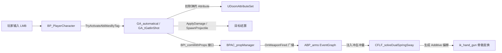
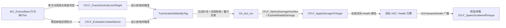
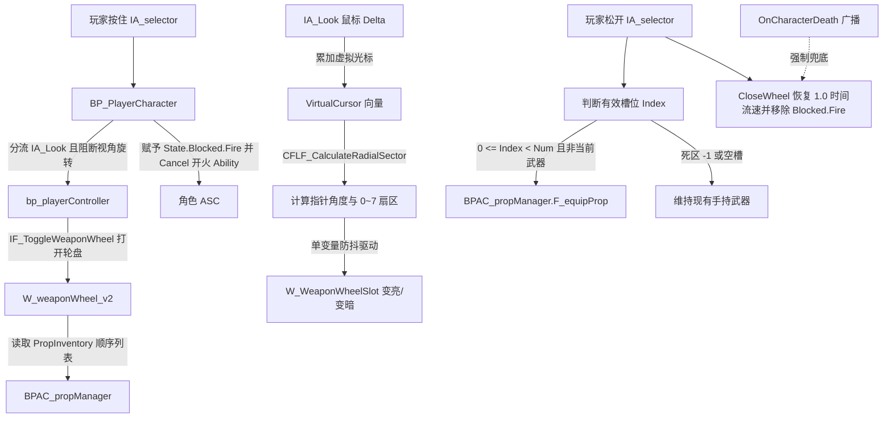

# 项目功能与实现总览 (PROJECT_MAP.md)

> **版本**：v1.0 (2026-11 阶段成果归档)  
> **地位**：本项目唯一真实数据源地图（Single Source of Truth），用于人机协作无缝交接，避免新会话重复扫描与逻辑断链。

---

## 1. 一句话项目定位 (Elevator Pitch)
基于 **Unreal Engine 5.8** 与 **Gameplay Ability System (GAS)** 构建的高机动、纯腰射（Hip-fire Only）第一人称射击（FPS）Demo。目标硬件锁定为 **NVIDIA GTX 1660 Super (6GB)** 达成 **1080p @ 60–120 FPS**。核心特色为全程序化第一人称双臂（IK + C++ 二阶弹簧驱动惯性/后坐力/呼吸）、模块化 3 类基础 AI、以及高质量 PBR 湿冷赛博地面与 3D 棱角碎石环境。

---

## 2. 已实现核心系统资产地图

| 模块分类 | 功能名称 | 核心实现方式 | 物理文件 / 资产引用路径 | 当前状态 |
| :--- | :--- | :--- | :--- | :--- |
| **角色基类** | 移动属性与死亡分发 | C++ 继承 `ACharacter` + `IAbilitySystemInterface`，内置 1.4s 串行 Dash 充能计时器与 `OnCharacterDeath` 事件 | `Source/GAS/DoomBaseCharacter.h/.cpp` | 已落地并验证 |
| **GAS 属性集** | 属性与生命周期门禁 | C++ 管理核心 6 项数值 (`Health`, `MaxHealth`, `JumpCount`, `MaxJumpCount`, `DashCount`, `MaxDashCount`)，移除多余物理冲量属性 | `Source/GAS/DoomAttributeSet.h/.cpp` | 瘦身优化验证完毕 |
| **玩家蓝图** | 输入与机动状态机 | 继承 `ADoomBaseCharacter`，Enhanced Input 映射，GAS 驱动 Dash、滑铲 (Slide)、蹬墙跳 (WallJump) | `/Game/bps/BP_PlayerCharacter` | 已完成 |
| **手部动画** | 虚拟枪骨与程序化惯性 2.0 | 虚拟枪骨 `ik_hand_gun` 架构 + 手腕 `hand_r` 独立后坐力 + 2.0 聚合解算器 (`CFLF_SolveHandSwayV2` / `CFLF_SolveRecoilSpringV2`) | `/Game/FirstPersonArms/customAnim/ABP_arms`<br>`Source/GAS/FPSAnimFunctionLibrary.h`<br>`Source/GAS/FPSAnimFunctionLibrary_Arms.cpp` | 2.0 调优完毕 |
| **武器中枢** | 装备管理与后坐力路由 | ActorComponent 负责武器挂载、插槽同步、开火接口路由与 UI 轮盘通信 | `/Game/bps/gameplayEffect-Ability/equipmentSys/BPAC_propManager` | 已完成 |
| **枪械实装** | 加特林机枪与全自动射击 | 继承 `BPCA_weaponBase`，通过 `GA_automatical` 与 `GA_tGatlinShot` 循环触发开火与伤害 | `/Game/bps/gameplayEffect-Ability/equipmentSys/props/utilities/weapons/BPCA_gatlingGun` | 可射击验证 |
| **伤害与掉落** | 统一伤害与花瓣抛洒 | C++ `CFLF_ApplyDamageToTarget`（优先 GAS GE 负数扣血，Fallback 引擎原生）+ `CFLF_SpawnScatteredPickups` | `Source/GAS/FPSAnimFunctionLibrary.h` | 已集成至死怪与爆炸 |
| **敌人 AI** | 炮塔型杂兵 (Turret) | `AIC_EnemyBase` 站桩扫描 + `CFLF_CheckAimAndLineOfSight` + `GA_bot_ChargeBeam` 蓄力重炮 | `/Game/bps/BP_enemy_Grunt_Turret`<br>`/Game/bps/AIC_EnemyBase` | 逻辑闭环 |
| **敌人 AI** | 近战追击杂兵 (Melee) | 寻路靠近 + `CFLF_SphereDamageHostiles` 范围扑击判定 + `GA_bot_MeleePounce` 扑杀 | `/Game/bps/BP_enemy_Grunt_Melee` | 逻辑闭环 |
| **敌人 AI** | 远程游走杂兵 (Ranged) | `CFLF_EvaluateCombatStance` 迟滞防抖游走 + `GA_bot_FirePlasma` 射击等离子投射物 | `/Game/bps/BP_enemy_Grunt_Ranged`<br>`/Game/bps/gameplayEffect-Ability/equipmentSys/props/projectile/BPA_projectile_GruntPlasma` | 逻辑闭环 |
| **环境地面** | 湿冷赛博沥青地面 v5 | 88% `Asphalt031` 粗粝基底 + 12% `Asphalt02` 稀疏裂纹破损岛 + 黑曜石镜面水洼 + 霓虹 SSR/Planar 倒影 | `/Game/customMaterials/CleanGround/v5/M_CyberCleanAsphalt_v5`<br>`MI_Ground_RoughAsphalt_v5` | 实机极佳 |
| **战损贴花** | 立体断崖坑洞与地缝 | `M_Decal_Pothole_v2` (360°断崖法线/阶梯暗影/BumpOffset视差) + `M_Decal_Crack` (地缝裂痕) | `/Game/customMaterials/Decals/M_Decal_Pothole_v2`<br>`/Game/customMaterials/Decals/M_Decal_Crack` | 已完成并保存 |
| **3D 碎石** | 实体棱角石块与簇群 | 4 种硬切面低模 `SM_CyberRubble_01~04` (18~36面, NoCollision) + 专属双色材质 + 3 级母子簇群 | `/Game/customMaterials/Meshes/Rubble/`<br>`L_cyber_showcase` (`Rubble_Dense_Cluster`, `Rubble_Sparse_Cluster`) | 实机验证通过 |
| **武器轮盘中枢** | 动态数据驱动 8 扇区切枪轮盘 | 常驻 `bp_playerController` 托管 + 虚拟光标累加 + `CFLF_CalculateRadialSector` + 单槽子控件解耦 + 战斗边界保护 | `/Game/Core/UI/WeaponWheel/W_weaponWheel_v2`<br>`/Game/Core/UI/WeaponWheel/W_WeaponWheelSlot` | Phase 1~2 已就绪 (C++纯函数已编译落地) |

---

## 3. 核心数据流链路地图 (Data Flow Architecture)

### 3.1 玩家开火与手臂动态闭环


### 3.2 手臂程序化惯性每帧计算链路 (ABP_arms 每帧 Tick)
```mermaid
flowchart TD
    Cam[摄像机 AimRotation] -->|计算角速度| F1[CFLF_calLookDragTarget]
    Vel[角色 LocalVelocity] -->|计算加减速与起跳/坠地| F2[CFLF_calMoveImpulseTarget]
    Phase[行走相位 InWalkPhase] -->|计算 8 字形 Lissajous 曲线| F3[CFLF_calWalkBobbingTarget]
    
    F1 -->|OutLookRot/Trans| S[CFLF_solveDualSpringSway 二阶欠阻尼弹簧]
    F2 -->|OutImpulseRot/Trans| S
    F3 -->|OutBobRot/Trans| S
    
    S -->|OutTotalRot & OutTotalTrans| ModifyBone[Transform (Modify) Bone: ik_hand_gun & spine_05]
```

### 3.3 敌人 AI 决策与伤害结算链路


### 3.4 武器轮盘输入与切枪动态闭环


---

## 4. C++ 函数库快速索引表 (`UFPSAnimFunctionLibrary`)

> **物理分文件架构 (类名不变，蓝图 0 断链)**：
> - 头文件：`Source/GAS/FPSAnimFunctionLibrary.h`（包含 4 个 `#pragma region` 逻辑块）
> - 实现文件：按 4 大领域拆分为小文件（150~250 行），告别单文件 1400 行时代！

| 领域 / 物理实现文件 | 函数名称 (DisplayName) | 核心算法与数据流 | 典型调用方与微调滑杆 | 状态 |
| :--- | :--- | :--- | :--- | :--- |
| **手臂与后坐力**<br>`FPSAnimFunctionLibrary_Arms.cpp` | **`CFLF_SolveHandSwayV2`** | 整合视角滞后+移动加减速+跳跃下沉+8字步态，外加独立落地短弹簧与硬限幅，输入常态扣除消除正反馈死循环 | `ABP_arms` (`F_calHandSwayV2`) / `FollowTimeSec`, `LandingReturnTimeSec`, `LandingDropCm` | 现役 2.0 核心 |
| **手臂与后坐力**<br>`FPSAnimFunctionLibrary_Arms.cpp` | **`CFLF_SolveRecoilSpringV2`** | 控制论闭式公式根据回正时间与弹性反算刚度，单帧速度脉冲注入 (上扬/后退/横摆)，二阶欠阻尼回中 | `ABP_arms` (`F_calHandSwayV2`) / `ReturnTimeSec`, `Bounciness`, `KickUpDeg`, `KickBackCm` | 现役 2.0 核心 |
| **手臂与后坐力**<br>`FPSAnimFunctionLibrary_Arms.cpp` | **`CFLF_calLookDragTarget`** | 角度差分算角速度 + 独立轴限幅与符号映射 (组件空间 Roll/Pitch/Yaw) | `customFL` / 供 1.0 老资产过渡兼容 | 1.0 废弃 (保留兼容) |
| **手臂与后坐力**<br>`FPSAnimFunctionLibrary_Arms.cpp` | **`CFLF_calMoveImpulseTarget`** | 水平加速度差分 + 空中抛物线上浮 + 落地负向特征码编码 | `customFL` / 供 1.0 老资产过渡兼容 | 1.0 废弃 (保留兼容) |
| **手臂与后坐力**<br>`FPSAnimFunctionLibrary_Arms.cpp` | **`CFLF_calWalkBobbingTarget`** | 步频驱动李萨如 8 字波 ($\sin(2\theta)$ 纵向 2x 颠簸, $\cos(\theta)$ 横向 1x 晃动) | `customFL` / 供 1.0 老资产过渡兼容 | 1.0 废弃 (保留兼容) |
| **手臂与后坐力**<br>`FPSAnimFunctionLibrary_Arms.cpp` | **`CFLF_solveDualSpringSway`** | 落地冲量解码 + 落地重锤直注速度 + 向量弹簧积分 (`VectorSpringInterp`) | `customFL` / 供 1.0 老资产过渡兼容 | 1.0 废弃 (保留兼容) |
| **战斗与技能**<br>`FPSAnimFunctionLibrary_Combat.cpp` | **`CFLF_ApplyDamageToTarget`** | 自动查找 ASC + 挂载 `GE_Damage` (`Data.Damage` 负数赋值) + 原生 Fallback | 武器/技能 / `DamageAmount` (伤害数值) | 现役核心 |
| **战斗与技能**<br>`FPSAnimFunctionLibrary_Combat.cpp` | **`CFLF_GiveAbilityToActor`** | 技能卡带动态插入，自动查重避免重复注册 | `ADoomBaseCharacter` / `AbilityClass` (技能蓝图类) | 现役核心 |
| **战斗与技能**<br>`FPSAnimFunctionLibrary_Combat.cpp` | **`CFLF_SphereDamageHostiles`** | 球形重叠 + `Team.Player` vs `Team.Enemy` 阵营互斥过滤 + 批量伤害 | 近战怪扑击 / `Radius`, `Damage` | 现役核心 |
| **战斗与技能**<br>`FPSAnimFunctionLibrary_Combat.cpp` | **`CFLF_ExplodeRadialDamage`** | 径向爆炸 + 距离线性衰减 (`Dist/Radius`) + 物理刚体冲量炸飞死怪 | 投射物爆炸 / `Radius`, `BaseDamage`, `ImpulseStrength` | 现役核心 |
| **战斗与技能**<br>`FPSAnimFunctionLibrary_Combat.cpp` | **`CFLF_StepSpringRecoil`** | 控制器视角后坐力步进解算，带自动回正与玩家主动下拉压枪抵消防对抗保护 | 视角开火 / `KickInterpSpeed`, `RecoverySpeed` | 现役核心 |
| **AI 感知与姿态**<br>`FPSAnimFunctionLibrary_AI.cpp` | **`CFLF_CheckAimAndLineOfSight`** | 眼部到胸部射线 (`ECC_Visibility`) + 水平点积前向夹角判定 | AI 射击前置 / `MaxAngleDegrees` (允许瞄准夹角) | 现役核心 |
| **AI 感知与姿态**<br>`FPSAnimFunctionLibrary_AI.cpp` | **`CFLF_EvaluateCombatStance`** | 忽略 Z 轴 2D 距离 + 施密特双阈值迟滞（Engage vs Disengage）防频繁踱步 | AI 移动状态机 / `EngageRange`, `DisengageRange` | 现役核心 |
| **UI 与特效**<br>`FPSAnimFunctionLibrary_UI.cpp` | **`CFLF_CalculateRadialSector`** | 虚拟光标死区截断 + $\text{Atan2}(X, -Y)$ 12点钟对齐顺时针角度 + 半扇区偏置居中整除 | `W_weaponWheel_v2` / `NumSectors` (默认8), `DeadZone` (默认35.0) | 现役核心 |
| **UI 与特效**<br>`FPSAnimFunctionLibrary_UI.cpp` | **`CFLF_GetUnscaledDeltaTime`** | 读取 `FApp::GetDeltaTime()` 绝对真实时间步长，杜绝 0.15x 子弹时间下 UI 平滑插值变迟钝 | `W_WeaponWheelSlot` / 供 `Vector2DInterpTo` 真实时间驱动 | 现役核心 |
| **UI 与特效**<br>`FPSAnimFunctionLibrary_UI.cpp` | **`CFLF_SpawnScatteredPickups`** | 环形等角度错位分布 + 刚体径向向外与向上冲量 + 随机三轴角冲量 | 角色死亡事件 / `Count`, `ScatterRadius`, `UpwardImpulse` | 现役核心 |
| **UI 与特效**<br>`FPSAnimFunctionLibrary_UI.cpp` | **`CFLF_SpawnScatteredPickupList`** | 数组化多类掉落物环形花瓣式物理抛洒 | 实体掉落 / `ScatterRadius`, `UpwardImpulse` | 现役核心 |
| **UI 与特效**<br>`FPSAnimFunctionLibrary_UI.cpp` | **`CFLF_SpawnImpactFlash`** | 命中点瞬态无阴影爆闪点光源，定时自毁无额外 Actor 开销 | 子弹击中 / `HitLocation`, `HitNormal`, `Intensity` | 现役核心 |

---

## 5. 跨模块核心通信契约表 (Core Communication Contracts)

| 序号 | 契约载体 (接口 / Tag / 属性) | 签名 / 类型 | 职责与数据流向 |
| :---: | :--- | :--- | :--- |
| **1** | `ADoomBaseCharacter::OnCharacterDeath` | `(AActor* Victim)` 动态多播 | 广播角色死亡；触发 UI 强制关闭与恢复 `TimeDilation = 1.0` |
| **2** | `BPAC_propManager::PropInventory` | `TArray<ABPA_propBase*>` | 只读公开属性；UI 初始化/呼出时拉取当前已装配武器列表 |
| **3** | `BPAC_propManager::currentPropIndex` | `int32` | 当前手持武器下标；UI 呼出时高亮当前槽位 |
| **4** | `BPAC_propManager::F_equipProp` | `(int32 newIndex)` 成员函数 | 切枪中枢；传入目标扇区索引，执行装配与网格体同步 |
| **5** | `BPA_propBase::(PropIcon, DisplayName)` | `(TSoftObjectPtr<UTexture2D>, FText)` | 武器基类元数据，各扇区子控件动态绑定的真实数据源 |
| **6** | `GameplayTag: State.Blocked.Fire` | `FGameplayTag` | 轮盘开启时赋予角色 ASC，阻塞 LMB 开火技能防止走火 |
| **7** | `BPI_PlayerUI::IF_ToggleWeaponWheel` | `(bool bOpen)` 接口函数 | 角色通过接口通知 PlayerController 显隐轮盘与切枪控制 |
| **8** | `W_weaponWheel::OnSectorConfirmed` | `(int32 ConfirmedIndex)` Dispatcher | 松开选择键时广播有效切枪索引（-1 或空槽则放弃切枪） |
| **9** | `CFLF_CalculateRadialSector` | `(FVector2D, int32, float, float&, int32&)` | C++ 纯函数；将虚拟光标映射为角度与 [0~7] 扇区索引 |

---

## 6. 当前开发阶段与下一步待办 (Roadmap)
1. **阶段总结**：
   - 基础环境与 AI 模块全部落地；
   - 武器轮盘系统 Phase 1~2 顺利就绪（`PROJECT_MAP.md` 契约录入完毕、`CFLF_CalculateRadialSector` 纯函数通过 C++ 编译落地）。
2. **下一步施工核心 (Phase 3~5 武器轮盘接入与打磨)**：
   - **Phase 3**：复制老项目切片贴图至 `/Game/Core/UI/WeaponWheel/Textures/`，搭建 `W_WeaponWheelSlot` 子控件与 `W_weaponWheel_v2` 主轮盘蓝图；
   - **Phase 4**：在 `bp_playerController` 中完成常驻实例创建、`BPI_PlayerUI` 实现与 `OnCharacterDeath` 死亡兜底；在 `BP_PlayerCharacter` 中分流 `IA_Look` 与 `IA_selector`；
   - **Phase 5**：实机 PIE 跑测，验证 120 FPS 子弹时间切枪手感、防走火拦截与空槽保护。
